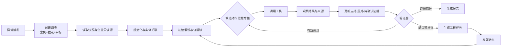

# 车辆缺陷主动调查决策 Agent

## 课程项目说明文档

### 1. 项目目标

本项目面向车企车辆安全调查员和质量工程师，构建一个能够组织公开与企业内部调查线索的 Agent 原型。它接收车型、部件、症状和调查目标，汇总投诉、维修、车辆配置、道路事件、工程文档和监管资料，根据当前证据缺口选择下一项核查，维护支持假设与替代解释，生成带验收条件的工程补查任务，并在新反馈进入后更新调查状态。

项目研究问题是：在相同资料截点和工具预算下，主动调查策略能否提高证据覆盖、反证发现、引用可核验性和调查结论的校准程度。

### 2. 课程要求对应

| 要求 | 本项目交付 |
|---|---|
| 5 分钟 PPT 与 Demo | 16 页展示稿，演示一条调查链和反馈后续跑 |
| 介绍目标、方法、成果、验证改进 | PPT 第 1–16 页，文档第 1–8 节 |
| 代码仓库与运行说明 | GitHub 仓库、README、`.env.local.example`、启动脚本 |
| 在线 Demo 或本地 Demo | `webapp.py` 本地网页，支持四个案例和完整交互 |
| 真实 Agent 构建 | 工具、计划、状态、记忆、验证、停止、重试、降级、日志 |
| 研究型验证 | 88 条 Qwen 主实验、V4 动态补充、264 条离线工程验证 |

### 3. 使用场景

调查员发现某车型的转向、制动、车门或动力系统投诉在短时间内集中。调查员在工作台创建调查，选择资料截点和目标，例如“寻找支持与反证”或“判断是否需要工程补查”。Agent 自动读取企业只读连接器和监管快照，建立初始假设，先执行能够区分假设的查询。当证据不足时，它生成带依据、验收条件和停止条件的补查任务。调查员审批任务并录入模拟维修或道路事件反馈，Agent 继续运行并保留未确认内容，最后生成带来源的调查报告和完整轨迹。

Demo 中的企业连接器使用脱敏本地模拟数据，接口形状对应投诉 CRM、保修维修、VIN 配置、道路事件、工程文档、监管资料和案件工作流。真实部署时可替换为企业只读 API，并通过权限、审计和人工审批层控制写入。

### 4. 项目迭代主线与系统演进

项目按照“先跑通、再纠错、再体现动态性、最后公平验证”的顺序推进。每一版都由上一版的失败样例驱动，先明确失败原因，再把原因转成数据契约、状态字段、验证规则或评测指标。下面的 V1–V4 过程同时说明系统为什么逐步变得更可靠，以及 Agent 的核心价值在哪里。

#### 4.1 V1–V4 的完整迭代逻辑

**V1：先证明闭环能够运行。** 第一版围绕 EA23003 直接实现五个本地工具，并用单 Agent 依次执行筛选、趋势、证据检索、实体关联和补查生成。状态写入 JSON，运行轨迹追加到 JSONL，报告中的来源和截点由程序检查。V1 的价值是把课程中的 Agent Loop 变成可执行工程，能够一条命令完成案例回放。V1 的不足是固定步骤很强，工具参数和数据质量问题会被带入后续结果，难以区分 Agent 的主动决策和普通流水线。

**V2：先修复数据和工具契约。** 实验发现 NHTSA 的通用车型名不能直接代替官方车型名，Honda Civic 查询出现 HTTP 400，直接把失败当作零投诉会造成系统性漏数。V2 先访问 vPIC 官方车型目录，再把 2023 Civic 展开为四个有效子车型并分别查询；每个请求保存原始 JSON、HTTP 状态、来源 URL、采集时间和 SHA-256。工具统一使用结构化参数和结构化返回，加入无效日期、未知工具、截点后材料、来源缺失和有限重试测试。V2 同时加入迁移案例和数据质量报告，保证后续比较使用同一套数据契约。

**V3：让动态性成为可观察行为。** 仅执行固定工具序列时，Agent 即使接入模型，也很难体现“根据状态选择下一步”。V3 引入六类状态：空结果、来源冲突、竞争性假设、证据充分、截点泄漏和补查缺口。每个支持假设都必须生成替代解释与反证查询，候选动作使用信息增益排序。24 条 Qwen 动态 pilot 显示主动 Agent 的首步动态动作正确率为 66.7%，同时暴露了两个问题：证据充分和截点泄漏需要安全门纠偏，模型在补查缺口场景中有时会过早停止。失败样例被写入下一版的验证规则和评测任务。

**V4：把动态 Agent 放进公平对照。** V4 冻结案例、资料截点、目标和工具预算，统一运行固定流程、普通 RAG、ReAct/确定性工具循环和主动调查 Agent。系统加入证据图、来源验证、重复调用停止、失败重试上限、状态续跑和反馈后更新。V4 不再把“调用更多工具”当作质量，而是记录证据覆盖、反证发现、引用可核验性、过度自信、结论更新和补查完整度。这样，实验可以同时回答 Agent 是否更动态、是否更安全、是否值得额外成本。


### 5. 最终技术架构

系统采用 Python 和轻量网页。数据层保存原始材料快照、规范化记录、证据文档和案例元数据；证据图层连接投诉、车型、部件、症状、调查、召回、来源文件和时间点；工具层提供 `search_records`、`analyze_trend`、`retrieve_evidence`、`link_entities`、`create_followup`；策略层提供固定流程、普通 RAG、ReAct/确定性工具循环和主动信息增益 Agent；验证器检查工具参数、来源、日期、截点和状态转换；状态层保存计划、假设、证据立场、待查任务、反馈、重规划次数和停止原因；报告层生成 Markdown 报告、JSON 状态快照和 JSONL 运行轨迹。

Agent 主循环为：计划 → 选择工具 → 观察 → 更新证据和假设 → 验证 → 必要时重规划 → 停止或生成补查任务。每轮最多 8 步，同一失败调用最多重试 2 次。模型输出必须转换为结构化动作，非法工具、无效日期、未声明参数、截点后材料和无来源事实会被拒绝或降级为待确认。

主动动作的排序使用：

`utility = expected_information_gain × source_reliability − retrieval_cost − duplication_penalty`

每个支持假设必须保留至少一个替代解释和对应反证查询。证据只允许标记为支持、反对、中性或待确认，并绑定到来源或确定性工具结果。

### 5.1 架构组件与数据流

| 层 | 输入 | 核心逻辑 | 输出与审计 |
|---|---|---|---|
| 数据快照层 | NHTSA API、调查文件、企业只读连接器 | 保存原始 JSON、来源 URL、公开日期、保存日期、SHA-256 | 原始 ID 不覆盖，便于重放 |
| 规范化层 | 投诉、维修、配置、事件和文档 | 日期统一、车型和部件标准化、重复候选标记、外键校验 | `records_normalized.json`、质量报告 |
| 证据图层 | 规范化记录和来源文档 | 建立投诉—症状—部件—调查—召回—来源关系，文本相似只形成候选边 | 关系依据、来源、截点和置信状态 |
| 工具层 | 当前调查状态和工具参数 | 记录检索、趋势、证据、实体关联、补查任务 | 统一结构化返回、错误码、来源字段 |
| Agent 策略层 | 计划、证据缺口、竞争性假设 | 计算候选动作信息增益，优先寻找能区分假设的查询 | 动作选择、重规划原因、停止原因 |
| 验证与边界层 | 模型动作和工具观察 | 检查工具名、参数、来源、日期、截点、事实依据和重复调用 | 通过、拒绝、降级、重试或人工补充 |
| 状态与报告层 | 已验证观察、反馈和任务结果 | 保存短期状态、失败记忆、JSONL 轨迹并生成报告 | 可回放状态、引用、未确认项和报告 |

一次调查的数据流如下：



系统把“模型建议”和“已验证事实”分开。模型只负责提出计划、候选动作和表达，工具结果负责提供事实，验证器负责决定哪些内容可以写入状态和报告。因此，模型偶尔返回包裹文本、未声明参数或过强结论时，系统仍能保持结构化运行。

### 6. 数据与案例

主案为 Honda/Acura 转向阻力调查 EA23003，回放截点为 2023-11-28。运行检索只读取该日期前公开的投诉和调查材料，后续结案结果单独保存为留出答案。研究包扩展了跨部件迁移案例，每案保留投诉、公开调查或召回材料、来源 URL、发布日期、保存时间、SHA-256 和质量报告，并生成多个历史截点。异常样本覆盖缺日期、来源冲突、重复投诉、未来材料、空检索和工具错误。

公开数据来自 NHTSA 投诉、召回、调查和 FLAT_INV 快照。NHTSA 投诉抓取先访问官方车型目录 API，确认年份和品牌下的有效车型名称；2023 Honda Civic 展开为 CIVIC SEDAN、CIVIC HATCHBACK、CIVIC SEDAN SI 和 CIVIC HATCHBACK TYPE R，分别请求 Complaints API。HTTP 400、count=0 且成功消息的响应标记为 `EMPTY_RESPONSE_UNVERIFIED`，不计为零投诉。官方投诉编号优先去重，同时保留车型来源和原始记录。

### 7. 实验与结果

四种方案在同一案例、同一资料截点和同一任务条件下运行：固定流程依次调用筛选、趋势、证据和实体关联；普通 RAG 只进行一次检索后回答；ReAct/确定性工具循环交错调用工具和观察但没有信息增益规划；主动 Agent 使用竞争性假设、证据图、反证优先和成本约束。

88 条 Qwen API 主实验的自动流程分为：固定流程 3.125/5，普通 RAG 2.125/5，ReAct/确定性工具循环 3.250/5，主动调查 Agent 3.193/5。结果说明主动 Agent 明显高于普通 RAG，和固定流程接近，略低于当前 ReAct 消融基线，因此不宣称它全面胜出。V4 24 条动态补充中，主动 Agent 首步动态动作正确率为 66.7%，固定流程 16.7%，普通 RAG 50%，确定性循环 16.7%。证据充分、截点泄漏等场景中的 100% 安全通过率表示安全门阻止了越界动作，不等于模型自主判断正确率。264 条离线任务全部通过，证明数据、工具、状态、日志、证据图和边界检查可复现，但不作为真实模型质量证据。

最终报告使用结果层、系统层和过程层指标：决策正确率、结论更新率、过度自信率、证据利用率、证据覆盖、反证发现、竞争性假设区分、引用可核验率、截点泄漏率、无来源断言率和补查任务完整度。工具调用数、延迟和 token 只用于成本诊断，不单独代表 Agent 质量。

### 7.1 为什么主动 Agent 当前略低于 ReAct

88 条 Qwen 主实验中，主动调查 Agent 为 3.193/5，ReAct/确定性工具循环为 3.250/5。这个差距不是因为主动 Agent 没有规划，而是因为当前实验中的 ReAct 基线更像一个稳定的工具使用策略：它看到工具观察后直接选择下一个动作，动作空间小、任务短、工具失败少，因此较少产生额外规划错误。主动 Agent 需要先维护竞争性假设、估计信息增益、检查反证和决定是否停止，增加了决策环节；当模型对证据缺口估计不准时，就会选择较弱的查询、重复查询，或在仍有缺口时停止。

这项结果具有研究价值。它说明“增加 Agent 组件”不会自动带来更高的任务分数，主动规划必须改善动作质量，而不是增加文字解释。当前 ReAct 在短任务上的优势来自执行稳定性，主动 Agent 的优势主要出现在需要跨轮状态更新、冲突处理、反证和反馈续跑的任务。V4 动态 pilot 中主动首步动作正确率高于固定流程和普通 RAG，支持这一点；但证据充分、截点泄漏等场景的安全通过率主要来自验证器和安全门，不能当作模型自主能力。

下一版应沿四个方向改进：第一，把动作规划拆成“候选动作生成”和“候选动作排序”，让规则化信息增益负责约束候选集合，再让模型排序，减少自由生成错误；第二，为每个任务预先给出最小验收条件和反证目标，避免模型把检索数量误当作调查完成；第三，把 ReAct 的稳定执行策略与主动 Agent 的证据图、竞争性假设结合，形成带状态记忆的混合策略；第四，在更长的反馈续跑任务上增加样本，单独报告首步选择、跨轮更新和最终结论校准，避免短任务掩盖 Agent 的长期价值。

### 8. Demo 运行与演示脚本

```bash
python -m venv .venv
source .venv/bin/activate
pip install -r requirements.txt
python webapp.py
```

打开 `http://127.0.0.1:8765`。建议演示：选择 EA23003，确认默认截点，填写“寻找支持与反证”，点击开始调查；查看企业数据源、初始假设、当前下一步、证据台账和工程核查任务；模拟来源冲突或维修反馈；点击继续调查，观察前后状态、假设置信度、补查任务和归档报告的变化。

使用 DeepSeek API 时，将自己的 Key 只写入本机 `.env.local`，或在终端设置 `MODEL_API_KEY`、`MODEL_BASE_URL=https://api.deepseek.com`、`MODEL_NAME=deepseek-chat`。仓库不保存密钥。没有 API 时选择离线 Agent 演示，完整流程仍可运行。

### 9. 能力边界与企业接入

Agent 可以自动组织多源材料、去重、统计趋势、建立实体关联、维护竞争性假设、寻找反证、提出可验收补查、保存状态和生成可追溯报告。高风险工程任务审批、来源冲突处置、车辆现场测试和最终安全缺陷认定仍由调查员或工程负责人完成。当前 Demo 使用本地脱敏连接器，未来可在企业内网部署，通过只读 API、权限管理、审计日志和案件工作流适配器接入现有系统。

### 10. 交付清单

- GitHub 代码仓库与分支：`v1-baseline`、`v2-data-contracts`、`v3-dynamic-policy`、`v4-final-demo`、`main`。
- `README.md`：安装、数据、API、Demo 和测试说明。
- `outputs/vehicle-defect-agent-final.pptx`：16 页展示稿。
- `docs/project-report.md` 与 Word/PDF 版本：项目说明文档。
- `enterprise_demo.html`、`webapp.py`：本地 Demo。
- `data/public_demo/`：精简演示数据。
- `data/eval/`、`docs/*results*.md`：评测任务、分层结果和失败分析。
- `tests/`：数据导入、NHTSA 车型映射、截点安全、状态和反馈续跑测试。

### 11. AI 协作与纠错记录

本项目把人机交互本身作为工程迭代证据。下面的原话记录了需求如何推动设计变化：

> “为什么固定流程、普通 RAG、Agent 均检索到 1 条证据，数目一样且都为 1，这结果没有问题吗？”

这次质疑促使项目把“命中证据数”从质量结论中剥离，增加动态动作、反证发现、结论更新和证据利用率指标。

> “你先看一下结果，避免出现上一次的‘把时间条件写成了工具未声明的 `before` 字段，以及 Qwen 偶尔返回带包裹文本或不规范动作’这种问题。”

这次反馈促使系统加入动作协议、参数验证、结构化解析、失败重试上限和运行前小样本检查。

> “根据 V3 的问题继续迭代，接下来进入 V4。在 V3 中为什么没有和其他几种解决方式的对比？”

这次反馈促使项目冻结四种公平基线，并把 V4 设计为统一案例、统一截点和统一工具预算的对照实验。

> “当前 demo 只能选择案例、展示案例调查细节，整个流程页面太平了，几乎没有可以点击交互的模块。”

这次反馈促使 Demo 从静态报告查看器改成调查员工作台，加入数据源查询、Agent 推进下一步、任务草稿、模拟反馈和反馈后续跑。

> “我希望有一个明确的期望正确率指标，或者多维的衡量标准也行，但是要突出为什么我的 agent 架构是有用的。”

这次反馈促使最终评测分成结果层、系统层和过程层，报告决策正确率、结论更新率、过度自信率、证据利用率、引用可核验率和截点泄漏率，而不是用工具调用次数代表质量。

这些交互对应四类实际纠错：数据纠错、协议纠错、实验纠错和产品纠错。AI 在本项目中的作用是提出实现草案、解析失败模式、生成评测方案和辅助修改；最终规则由确定性验证器、测试和人工检查共同确认。

### 12. 参考资料

- Yao et al., ReAct, 2022: https://arxiv.org/abs/2210.03629
- Schick et al., Toolformer, 2023: https://arxiv.org/abs/2302.04761
- Asai et al., Self-RAG, 2023: https://arxiv.org/abs/2310.11511
- Yan et al., CRAG, 2024: https://arxiv.org/abs/2401.15884
- Shinn et al., Reflexion, 2023: https://arxiv.org/abs/2303.11366
- NHTSA datasets and APIs: https://www.nhtsa.gov/nhtsa-datasets-and-apis
